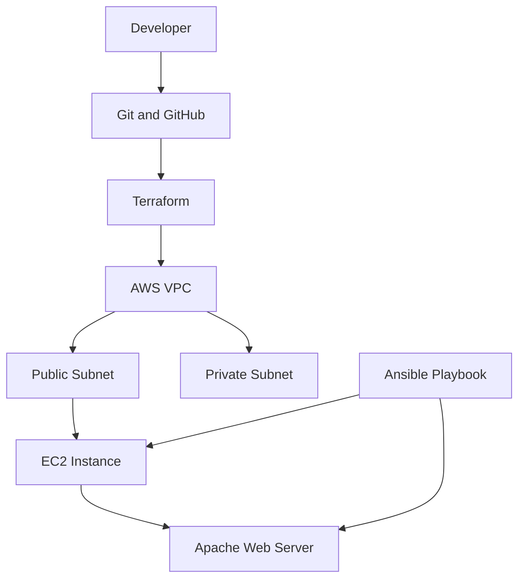

# AWS Infrastructure Automation using Terraform and Ansible

## Project Overview

This project demonstrates Infrastructure as Code (IaC) using Terraform and automated server configuration using Ansible.

Terraform is used to define AWS infrastructure, including VPC, subnets, networking components, security groups, and EC2 instances. Ansible is used to automate Apache web server installation and configuration.

The project is developed and tested locally using Ubuntu on WSL. AWS infrastructure deployment is planned but has not yet been performed.

## Technologies Used

- AWS
- Terraform
- Ansible
- Git and GitHub
- Linux (Ubuntu)
- Apache Web Server

## Project Objectives

- Create an AWS VPC and subnets using Terraform.
- Configure Internet Gateway and route tables.
- Create security groups for web traffic.
- Define EC2 infrastructure using Terraform.
- Automate Apache web server configuration using Ansible.
- Manage project source code using Git and GitHub.

## Current Implementation

### Terraform

Terraform configuration has been created for:

- AWS VPC
- Public and private subnets
- Internet Gateway
- Public and private route tables
- Route table associations
- Security group
- Amazon Linux 2023 AMI lookup
- EC2 instance
- Terraform outputs for resource information

Terraform initialization, formatting check, and validation have been completed successfully.

### Ansible

Ansible playbook has been created to:

- Install Apache web server.
- Start and enable the Apache service.
- Create a custom website index page.

The playbook was executed successfully on Ubuntu WSL.

### Apache Web Server

Apache was installed and verified locally.

The website response was tested using:

```bash
curl http://localhost
```

Expected response:

```text
Welcome to AWS DevOps Infrastructure Project
```

## Architecture Diagram

The following diagram represents the intended AWS architecture.



> **Note:** This diagram represents the intended AWS architecture. AWS resources have not yet been deployed. Ansible and Apache have been tested locally on Ubuntu WSL.

## Project Structure

```text
aws-infrastructure-automation/
│
├── terraform/
│   ├── main.tf
│   ├── variables.tf
│   ├── providers.tf
│   └── outputs.tf
│
├── ansible/
│   ├── ansible.cfg
│   ├── inventory.ini
│   └── playbook.yml
│
└── README.md
```

## How to Test Locally

### 1. Validate Terraform

```bash
cd terraform
terraform fmt -check
terraform init
terraform validate
```

### 2. Test Ansible

```bash
cd ../ansible
ansible-playbook playbook.yml --syntax-check
ansible-playbook playbook.yml -K
```

### 3. Verify Apache

```bash
curl http://localhost
```

## Project Status

- Terraform configuration: Created and validated.
- Ansible playbook: Executed successfully on Ubuntu WSL.
- Apache web server: Installed and verified locally.
- GitHub repository: Source code pushed successfully.
- AWS infrastructure deployment: Not yet performed.

## Cost Consideration

AWS resources have not been deployed as part of the current implementation. Local testing was performed using Ubuntu WSL to avoid AWS infrastructure charges.

## Learning Outcomes

- Understanding Infrastructure as Code using Terraform.
- Creating AWS infrastructure configurations.
- Automating server configuration using Ansible.
- Managing Linux services.
- Installing and configuring Apache web server.
- Using Git and GitHub for version control.
